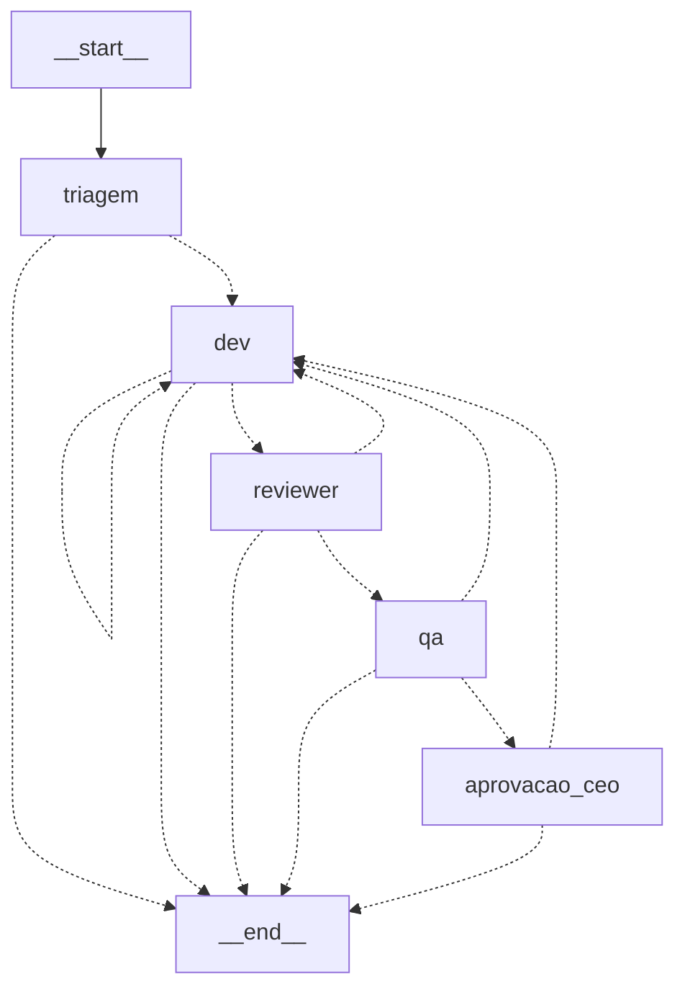

# Task 2 — Grafo do tracer bullet

Caminho fino, de ponta a ponta, com o **modelo real** num ticket trivial:
`triagem → dev → reviewer → qa → aprovacao_ceo → deploy simulado`.

## Arquivos

- `orchestrator/src/graph.ts` — estado (zod), 5 nós, arestas, relatório de consumo.
- `orchestrator/src/guardrails.ts` — Seção 1 inicial (`MAX_REVISOES`, `RECURSION_LIMIT`,
  `TIMEOUT_POR_NO_MS`, `verificarEvidencia`) e Seção 2.
- `orchestrator/scripts/tracer.ts` — cria um **repo-fixture descartável** em pasta temporária,
  um worktree por ticket, roda o grafo e imprime o relatório.

## Estado do ticket

Um schema zod (`Ticket`). Além dos campos pedidos (id, titulo, prioridade, especialidade,
flags, status, resumo, autor_id, revisor_id, qa_id, revisoes, evidencias, historico) entram
**4 extras mínimos** que o código precisa: `pedido` (texto do CEO), `criterios` (critérios
de aceite que o dev/reviewer/qa recebem), `worktree` e `base` (commit de partida, para o diff
e para checar que houve commit novo). `resumo` tem no máximo 10 linhas (refine do zod).

## Nós

| Nó | Prompt (lido de `AGENTS_DIR`) | Contexto montado pelo código |
|---|---|---|
| triagem | `triagem` | só o pedido do CEO |
| dev | `dev-<especialidade>` (`ia`→`engenheiro-ia`, `dados`→`engenheiro-dados`) | ticket + critérios + resumo |
| reviewer | `code-reviewer` (+ `seguranca`/`performance`/`engenheiro-evals` conforme flag) | diff + critérios + resumo |
| qa | `qa-automation` | diff + critérios + resumo |
| aprovacao_ceo | humano | `interrupt()` com resumo e evidências |

Diff de reviewer/qa é calculado pelo código (`git diff base HEAD`, truncado em 20k caracteres).
Nenhum prompt foi duplicado ou criado.

## Arestas



(Gerado por `graph.getGraphAsync().drawMermaid()`; `npm run tracer -- --mermaid` imprime.)

Regras de roteamento (`rota` / `aposRevisao`): sucesso segue; reprovação ou verificação
falha volta ao dev com `revisoes + 1`; `revisoes >= MAX_REVISOES` ou qualquer falha de nó
(`FalhaDeNo`: erro, timeout, saída inválida, limite de turnos) termina o ticket com
`status=escalado` e o motivo no `resumo`. Triagem "ambígua" termina com `status=ambiguo`
(o planejador entra na task 4). Nesta fase o teto estoura para `END`; a task 3 troca por
`aprovacao_ceo`.

## Verificação por código (zero token)

`verificarEvidencia(worktree, base)` roda após o dev: existe commit novo
(`git rev-list --count base..HEAD`) e `npm test` passa no worktree. Só então o ticket segue; o
`autor_id` vem do autor do commit (identidade `agente-dev` injetada pelo env), e
`evidencias` recebe `commit:<sha>` e `testes:npm test ok`. A declaração do agente não conta.

## O tracer

Fixture: `checkout.html` com `<button>Enviar</button>` e um teste (`node --test`) que exige
`>Enviar pedido<`; o teste nasce vermelho. Pedido: trocar o texto do botão. A pausa do CEO é
lida do stdin, então o teste automatizado respondeu `aprovar` (o fixture é descartável,
nada real foi aprovado ou publicado).

```
cd orchestrator && cp .env.example .env
echo aprovar | npm run tracer -- --limpar     # --mermaid imprime o diagrama
```

## Linha de base de consumo (modelo padrão do projeto, esforço médio)

| Nó | Tokens (ctx + saída) | Turnos | Tempo | US$ equiv. |
|---|---|---|---|---|
| triagem | 10.842 (ctx 10.117, saída 725) | 3 | 7,3 s | 0,011 |
| dev | 41.421 (ctx 40.591, saída 830) | 6 | 12,1 s | 0,021 |
| reviewer | 11.749 (ctx 10.947, saída 802) | 4 | 8,2 s | 0,016 |
| qa | 17.820 (ctx 16.466, saída 1.354) | 6 | 12,4 s | 0,023 |
| **ticket** | **81.832** | 19 | 40,1 s | **0,071** |

"ctx" soma `input + cache_creation + cache_read` **de todos os turnos** do nó (o contexto é
relido a cada turno); por isso nó com mais turnos parece maior. O número a vigiar para
reduzir consumo é turnos × contexto por turno (~3,4k a 6,7k tokens por turno aqui). O custo em
US$ é só o equivalente de API; o uso real é descontado do limite do plano.
Antes desta medição, uma tentativa com `reviewer`/`qa` sem permissões corretas custou menos,
mas não é comparável (o dev nem editava).

## Bugs encontrados e corrigidos no caminho

1. **`deny Write(~/**)`** casava com o worktree, porque o temp do Windows fica dentro do
   home do usuário (a negação sempre vence). Removido; o escopo é dado por `Write(./**)`.
2. **Shell do dev:** no Windows o `claude -p` expõe `PowerShell`, não `Bash`. Sem isso o dev
   editava e não conseguia commitar. A tabela agora usa `SHELL` por plataforma
   (`PowerShell` no Windows, `Bash` em POSIX).
3. **Git com `os.devNull`:** no Windows é `\\.\nul`, que o git rejeita
   (`unable to access '\\.\nul'`). Agora `NUL` (Windows) / `/dev/null`.
4. **Env mínimo sem `ProgramFiles`:** adicionados `ProgramFiles*`, `SystemDrive` e
   `CLAUDE_CODE_GIT_BASH_PATH` à whitelist.
5. **`comentarios` do QA** com mais de 10 linhas derrubava o nó (saída inválida, falha
   fechada). A regra de 10 linhas vale para o `resumo` que passa adiante; o código trunca.
6. `execFileSync` com `shell: true` gerou o aviso DEP0190; trocado por `execSync` de comando
   fixo.

## Fronteiras validadas ao vivo (dev real, `permission_denials`)

- Ler `.env` do worktree: **negado**.
- Escrever fora do worktree (`../fora.txt`): **negado** (modo `dontAsk`).
- Editar `checkout.html` dentro do worktree e commitar: permitido.
- `git push`: não coberto por teste ao vivo desta vez (o agente não conseguiu usar shell no
  momento do teste, antes da correção 2); está fora da allowlist e na denylist, e a env não tem
  credencial. Fica como item do teste de aceitação da task 3.

## Limites conhecidos

- O reviewer/qa não têm shell (leitura apenas); por isso o QA declarou que "não rodou
  `npm test`". Os testes são rodados pelo grafo, que é a evidência que conta.
- Agentes citam Playwright/Nielsen dos prompts originais, que não existem nesta sessão
  enxuta (sem MCP). Isso é ruído de prompt, não de código; o recorte do prompt por papel fica
  como melhoria de tokens se o consumo pesar.
