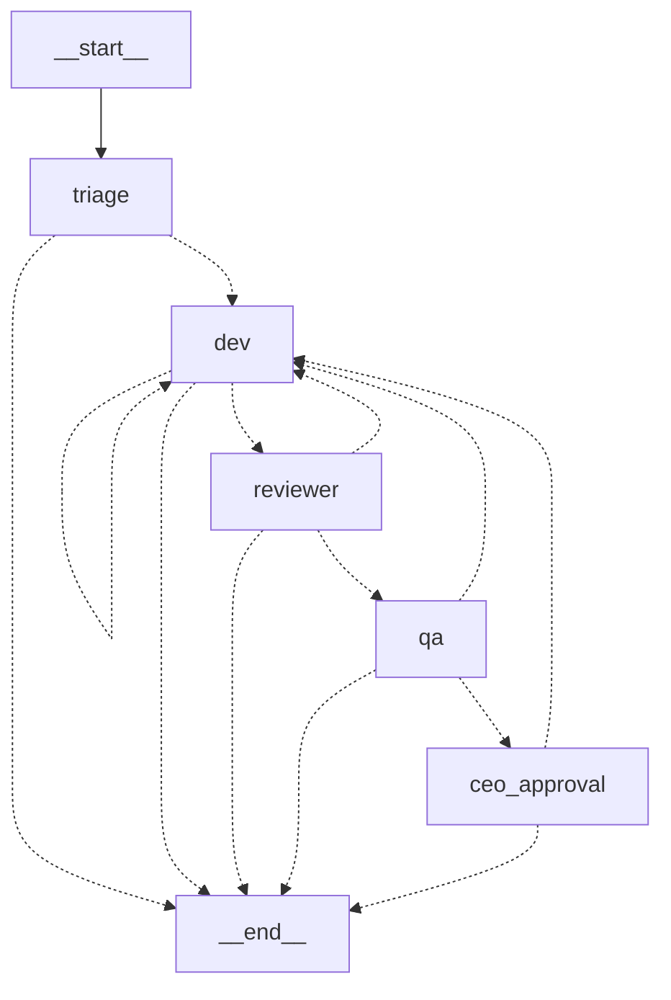

# Task 2 — Tracer bullet graph

A thin, end-to-end path with the **real model** on a trivial ticket:
`triage → dev → reviewer → qa → ceo_approval → simulated deploy`.

## Files

- `orchestrator/src/graph.ts` — state (zod), 5 nodes, edges, consumption report.
- `orchestrator/src/guardrails.ts` — initial Section 1 (`MAX_REVISIONS`,
  `RECURSION_LIMIT`, `NODE_TIMEOUT_MS`, `verifyEvidence`) and Section 2.
- `orchestrator/scripts/tracer.ts` — creates a **disposable fixture repo** in a temp
  folder, one worktree per ticket, runs the graph and prints the report.

## Ticket state

A zod schema (`Ticket`). Besides the requested fields (id, title, priority, specialty,
flags, status, summary, author_id, reviewer_id, qa_id, revisions, evidence, history),
**4 minimal extras** the code needs: `request` (the CEO's text), `criteria` (acceptance
criteria the dev/reviewer/qa receive), `worktree` and `base` (starting commit, for the
diff and to check that a new commit exists). `summary` has at most 10 lines (zod
refine).

## Nodes

| Node | Prompt (read from `AGENTS_DIR`) | Context assembled by the code |
|---|---|---|
| triage | `triage` | only the CEO's request |
| dev | `dev-<specialty>` (`ai`→`ai-engineer`, `data`→`data-engineer`) | ticket + criteria + summary |
| reviewer | `code-reviewer` (+ `security`/`performance`/`evals-engineer` per flag) | diff + criteria + summary |
| qa | `qa-automation` | diff + criteria + summary |
| ceo_approval | human | `interrupt()` with summary and evidence |

The reviewer/qa diff is computed by the code (`git diff base HEAD`, truncated at 20k
characters). No prompt was duplicated or created.

## Edges



(Generated by `graph.getGraphAsync().drawMermaid()`; `npm run tracer -- --mermaid`
prints it.)

Routing rules: success moves on; rejection or a failed verification goes back to the dev
with `revisions + 1`; `revisions >= MAX_REVISIONS` or any node failure (`NodeFailure`:
error, timeout, invalid output, turn limit) ends the ticket with `status=escalated` and
the reason in `summary`. An "ambiguous" triage ends with `status=ambiguous` (the planner,
task 4, takes over this route). In this phase the cap overflows to `END`; task 3 replaces
that with `ceo_approval`.

## Verification by code (zero tokens)

`verifyEvidence(worktree, base)` runs after the dev: a new commit exists
(`git rev-list --count base..HEAD`) and `npm test` passes in the worktree. Only then does
the ticket move on; `author_id` comes from the commit author (identity `agent-dev`
injected by the env), and `evidence` receives `commit:<sha>` and `tests:npm test ok`. The
agent's declaration does not count.

## The tracer

Fixture: `checkout.html` with `<button>Submit</button>` and a test (`node --test`) that
requires `>Submit order<`; the test is born red. Request: change the button text. The
CEO pause is read from stdin, so the automated test answered `approve` (the fixture is
disposable, nothing real was approved or published).

```
cd orchestrator && cp .env.example .env
echo approve | npm run tracer -- --clean     # --mermaid prints the diagram
```

## Consumption baseline (project default model, medium effort)

| Node | Tokens (ctx + output) | Turns | Time | US$ equiv. |
|---|---|---|---|---|
| triage | 10,842 (ctx 10,117, output 725) | 3 | 7.3 s | 0.011 |
| dev | 41,421 (ctx 40,591, output 830) | 6 | 12.1 s | 0.021 |
| reviewer | 11,749 (ctx 10,947, output 802) | 4 | 8.2 s | 0.016 |
| qa | 17,820 (ctx 16,466, output 1,354) | 6 | 12.4 s | 0.023 |
| **ticket** | **81,832** | 19 | 40.1 s | **0.071** |

"ctx" sums `input + cache_creation + cache_read` **across all turns** of the node (the
context is re-read every turn); that is why a node with more turns looks bigger. The
number to watch to reduce consumption is turns × context per turn (~3.4k to 6.7k tokens
per turn here). The US$ cost is only the API equivalent; real usage is charged against
the plan limit. Before this measurement, an attempt with `reviewer`/`qa` without the
right permissions cost less, but it is not comparable (the dev did not even edit).

## Bugs found and fixed along the way

1. **`deny Write(~/**)`** matched the worktree, because the Windows temp folder lives
   inside the user's home (a deny always wins). Removed; the scope is given by
   `Write(./**)`.
2. **Dev shell:** on Windows `claude -p` exposes `PowerShell`, not `Bash`. Without it the
   dev edited but could not commit. The table now uses `SHELL` per platform
   (`PowerShell` on Windows, `Bash` on POSIX).
3. **Git with `os.devNull`:** on Windows it is `\\.\nul`, which git rejects
   (`unable to access '\\.\nul'`). Now `NUL` (Windows) / `/dev/null`.
4. **Minimal env without `ProgramFiles`:** added `ProgramFiles*`, `SystemDrive` and
   `CLAUDE_CODE_GIT_BASH_PATH` to the whitelist.
5. **QA `comments`** with more than 10 lines brought the node down (invalid output, fail
   closed). The 10-line rule applies to the `summary` that is passed on; the code
   truncates.
6. `execFileSync` with `shell: true` raised the DEP0190 warning; replaced by `execSync`
   with a fixed command.

## Boundaries validated live (real dev, `permission_denials`)

- Reading the worktree's `.env`: **denied**.
- Writing outside the worktree (`../outside.txt`): **denied** (`dontAsk` mode).
- Editing `checkout.html` inside the worktree and committing: allowed.
- `git push`: not covered by a live test this time (the agent could not use the shell at
  the time of the test, before fix 2); it is outside the allowlist and in the denylist,
  and the env has no credential. It stays as an item of task 3's acceptance test.

## Known limits

- The reviewer/qa have no shell (read-only); that is why the QA stated it "did not run
  `npm test`". The tests are run by the graph, which is the evidence that counts.
- Agents cite Playwright/Nielsen from the original prompts, which do not exist in this
  lean session (no MCP). That is prompt noise, not code noise; trimming the prompt per
  role stays as a token improvement if consumption weighs.

## Hardening after the security review (round 3)

- `verifyEvidence` refuses the ticket (escalates to the CEO) if the diff touches
  `package.json` or `.npmrc`, because `npm test` runs those scripts on the host;
  `npm test` has a timeout.
- Host-side git goes through `safeGit`: `core.fsmonitor=false`, `core.pager=cat`,
  `GIT_CONFIG_NOSYSTEM`, empty `GIT_EXTERNAL_DIFF`; the diff uses `--no-ext-diff
  --no-textconv`.
- The dev does not write the worktree's `.git` file (`Write/Edit(**/.git)`; `**/.git/**`
  did not cover it) and does not use `git log/diff --output`.
- **Residual:** tests written by the dev itself still run on the host. The full
  mitigation is an OS/container sandbox, outside the scope of this thin layer.
- Tests: `tests/evidence.test.ts` (no commit, diff in `package.json`, valid commit).
