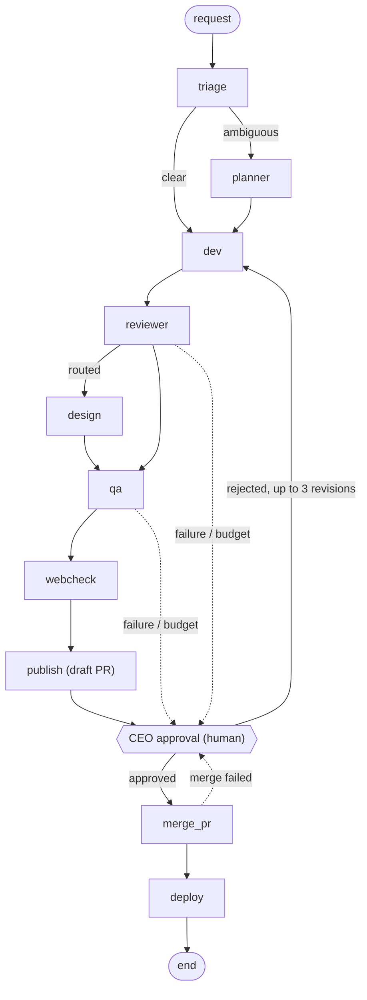

# Agent Softhouse Orchestrator

A TypeScript CLI where a [LangGraph.js](https://langchain-ai.github.io/langgraphjs/) state machine drives a team of AI agents (triage, planner, dev, reviewer, QA) from a plain-English request to a draft PR, then to merge and deploy after a human approves.

- The flow is a graph in code. The model cannot skip a step by being persuaded.
- Limits (token budget, revision cap, no self-approval) are code checks, not prompt advice.
- Nothing merges or deploys without an explicit human decision on verified evidence.

## The ticket graph

Derived from [`orchestrator/src/graph.ts`](orchestrator/src/graph.ts). The `docs_start`, `docs_mid` and `docs_end` nodes (project docs) are left out for readability. Any agent failure, timeout, exceeded budget or the revision cap sends the ticket to the human gate instead of crashing.



## Run it in 3 commands

Needs Node 24 or newer.

```bash
cd orchestrator
npm ci
npm run test:unit
```

The unit tests need no network, no model and no credentials (81 tests passed on a clean clone).

A real run (`npm run orch -- run "<request>" --repo <path>`) needs the Claude Code CLI logged in, a `.env` copied from `orchestrator/.env.example`, and a target git repo. Running `npm run orch` with no arguments prints the command list. I did not execute a live model run for this README.

## Key decisions

- **Flow as a graph in code, not a prompt:** nodes and edges live in [`graph.ts`](orchestrator/src/graph.ts); tested in [`graph.part1.int.test.ts`](orchestrator/tests/graph.part1.int.test.ts).
- **Guardrails enforced in code:** token budget fails closed ([`flow-limits.ts`](orchestrator/src/flow-limits.ts), test "an exceeded token budget interrupts the ticket"); revision cap of 3 ("the cap of 3 revisions escalates to the CEO"); reviewer and QA refuse to run if they authored the commit ("self-approval blocked").
- **Irreversible actions need a human:** merge and deploy sit behind a LangGraph `interrupt()` in [`ceo-node.ts`](orchestrator/src/ceo-node.ts); the approval is bound to the published commit SHA and re-verified ([`graph.part1.int.test.ts`](orchestrator/tests/graph.part1.int.test.ts), [`graph.part2.int.test.ts`](orchestrator/tests/graph.part2.int.test.ts)).
- **Single prompt source:** [`orchestrator/agents/`](orchestrator/agents) is canonical; [`.claude/agents/`](.claude/agents) holds one-line pointer stubs, checked by [`conventions.int.test.ts`](orchestrator/tests/conventions.int.test.ts), and `loadPrompt` refuses to load a stub ([`run-agent.test.ts`](orchestrator/tests/run-agent.test.ts)).
- **Verified evidence:** reviewer, QA and the CEO gate re-check the commit and test evidence before acting ([`evidence.ts`](orchestrator/src/evidence.ts), [`review-nodes.ts`](orchestrator/src/review-nodes.ts)), rather than trusting the agent's summary.

## Go deeper

- [TEAM.md](TEAM.md) - the agent roster and how to reuse it.
- [CLAUDE.md](CLAUDE.md) - the rulebook the agents follow (instructions for the AI).
- [orchestrator/README.md](orchestrator/README.md) - orchestrator usage.
- [orchestrator/docs/](orchestrator/docs/README.md) - design notes, measurements and hardening, one file per phase.
- [docs/portfolio/](docs/portfolio/README.md) - the case study: problem, architecture, guardrails, cost, evaluation, limits.

License: MIT ([orchestrator/LICENSE](orchestrator/LICENSE)).
