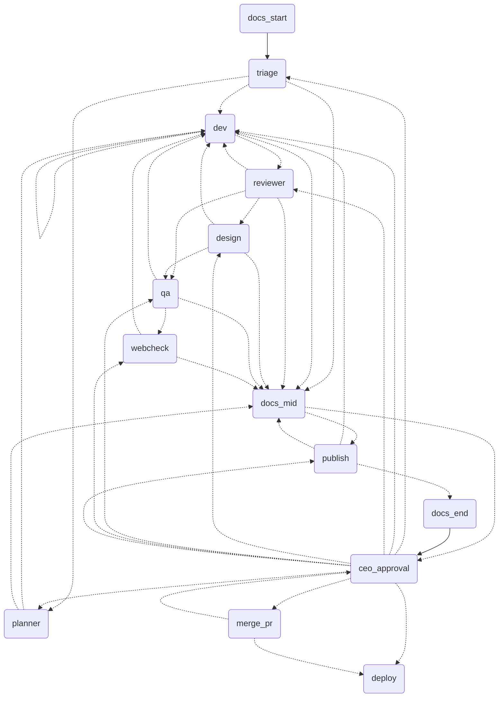

> Part of the [Agent Softhouse Orchestrator case study](README.md) — system overview and ticket flow

## 4. System overview

### Components

| Component | File | Responsibility |
|---|---|---|
| Graph | `src/graph.ts` | Nodes, conditional edges, escalation routing (node bodies live in `plan-nodes.ts`, `dev-node.ts`, `review-nodes.ts`, `ship-nodes.ts`, `ceo-node.ts`, `webcheck.ts`, `docs-node.ts`; the ticket schema is `src/ticket.ts`) |
| Executor | `src/run-agent.ts` | Runs one agent as a `claude -p` subprocess, parses/validates output, retries transient errors |
| Guardrails | `src/guardrails.ts` (re-exports `flow-limits.ts`, `permissions.ts`, `evidence.ts`, `git-safe.ts`, `modularity.ts`) | Limits, per-role permission table, minimal env, evidence verification |
| Publisher | `src/publish.ts` | Pushes the verified SHA and opens a **draft** PR (code, not agent) |
| Deploy | `src/deploy.ts` | Pluggable `DeployTarget` (simulated sandbox, or an external command) |
| Monitor / probe | `src/monitor.ts`, `src/probe.ts` | HTTP health checks, incident creation |
| Incidents | `src/incidents.ts` | File-backed store with fingerprint dedupe |
| Chaos | `src/chaos.ts` | Sandbox-only failure injection |
| Postmortem | `src/postmortem.ts` | Writes a sanitized postmortem into `playbooks/` |
| Ticket store | `src/ticket-store.ts` | One state file and one lock per ticket |
| Checkpointer | `src/file-saver.ts` | JSON-file `MemorySaver` so approval can happen in a later process |
| Repo config | `src/repo-config.ts` | Per-repo settings (test command, merge policy, publisher, deploy) |
| Watchdog | `src/watchdog.ts` | Rule-based detection of stalled, looping or over-budget tickets (no model) |
| Team | `src/team.ts`, `src/specialties.ts` | Per-repo choice of dev specialties and stack (`orch team`) |
| Webcheck | `src/webcheck.ts`, `src/webcheck-evaluate.ts` | Code node: starts the app, checks GTM/GA4/Ads ids and Web Vitals budgets in Chromium |
| Project docs | `src/docs-node.ts`, `src/docs.ts` | Read-only `docs` agent output validated and written by code under `.claude/docs` |
| CLI | `scripts/orch.ts` | `init`, `setup`, `team`, `run`, `status`, `continue`, `approve`, `reject`, `clean`, `watch`, `chaos`, `rollback`, `resolve` |

### Non-invasive by design

The orchestrator reads its role prompts from `orchestrator/agents/` (the single prompt source; 21 role prompts as of 2026-11-08) and the repo rules from `CLAUDE.md`. `.claude/agents/*.md` are one-line pointer stubs to those prompts, so `/request`, `/ticket` and `/demand` read the same text and no prompt is duplicated. A check in `loadPrompt` fails if `AGENTS_DIR` points at the stubs, and `tests/conventions.int.test.ts` fails if a stub drifts from the pointer line.

---

## 5. How a ticket flows

1. **Triage** (read-only agent) classifies the request: priority, specialty, risk flags (schema, public API, permissions, external integration, cost), and whether it is clear enough to build.
2. **Clear** → straight to the dev. **Ambiguous** → the **planner** node (demand analyst + product manager + tech lead in one call) writes a briefing and acceptance criteria, or asks the CEO a scoping question. The CEO's answer loops back to the planner.
3. **Large request** → the planner splits it into **atomic tasks**; the dev runs them one at a time, each verified before the next.
4. **Dev** works in an isolated git worktree (`ticket/<id>`, kept outside the repo) with a restricted tool set and commits its work.
5. **Code verifies the evidence** (new commit, clean tree, allowed paths, tests pass). Only then the ticket moves on.
6. **Reviewer** and **QA** (read-only, different identities from the author) receive the diff plus the code-verified evidence. UI tickets (`frontend`, `fullstack`) also pass through **design** (read-only) after the reviewer and **webcheck** (code) after QA. A rejection sends the ticket back to the dev with `revisions + 1`; at 3 revisions it escalates.
7. **Publish** (code) pushes exactly the verified SHA and opens a **draft PR**.
8. **CEO approval** is a LangGraph `interrupt()`. The CEO sees a plain-language explanation, the evidence, the PR and the active risk flags, and answers `orch approve` or `orch reject "reason"`.
9. **Merge** (opt-in `merge: auto`) squash-merges the approved commit only if CI is green and stable; otherwise the PR is left to the human.
10. **Deploy** runs through the configured `DeployTarget`, then the operations loop takes over.

The `docs_start`, `docs_mid` and `docs_end` nodes record project docs around the flow and never block a ticket. Each delivery also carries a **brief** (why, how, where it applies) that is bounded and escaped before it reaches prompts or the PR body.

