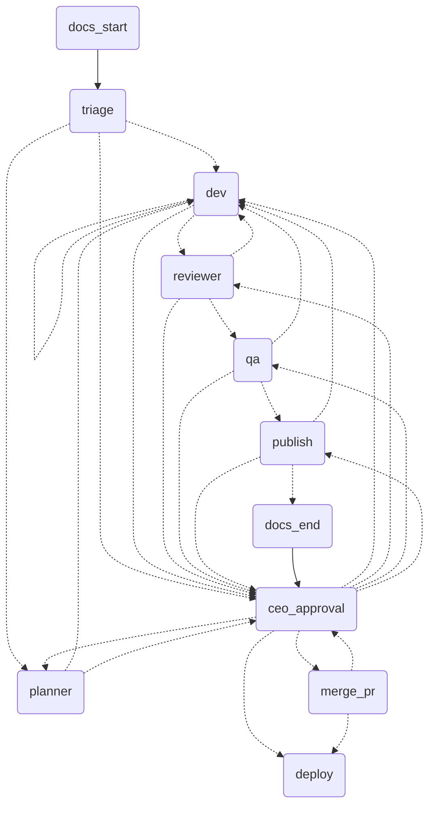

# Orchestrator

Flow control in code, not in prompts: a LangGraph.js graph orchestrates `claude -p` agents with code-verified guardrails.



- **Drop-in (copy and paste into any repo):** copy this whole folder to the root of the target repo, then `cd orchestrator && npm ci && cp .env.example .env`. It works on the repo that contains it (its parent), uses its own `agents/`, and keeps all state in `orchestrator/.state/` (gitignored); nothing global is read (the external config for real deploys is `.state/config.json`; set `ORCH_HOME` to keep it elsewhere). Commit the folder so tickets branch from a base that has it. If the repo's test command globs the whole tree (e.g. a bare `node --test`), it will also run `orchestrator/tests` inside every ticket worktree and fail: `orch init` detects a bare `node --test` script and writes it scoped (e.g. `node --test tests`); if you edit `test` by hand, keep it scoped. Commands, run from `orchestrator/`: `npm run orch -- init` (writes `../.orchestrator.json`; commit it), `npm run orch -- run "request"`, `orch status [id]`, `orch continue <id>` (resumes a run that was killed mid-graph), `orch approve <id> ["answer"]`, `orch reject <id> "reason"`, `orch clean <id>|--all [--force] [--remote]` (removes worktree, branch and state of finished tickets; `--remote` also deletes `ticket/<id>` on the push remote; before deleting, it appends one line of numbers to `ORCH_HOME/metrics.jsonl`: route, tasks, revisions, escalations, time, tokens and cost, total and per node). State lives in `ORCH_HOME` (default `orchestrator/.state`); ticket worktrees and deploy checkouts live in `ORCH_WORK` (default `~/.orchestrator/work`), outside the repo so the agent cannot reach its `.env` with `../`, one `tickets/<id>.json` per ticket with a `tickets/<id>.lock` while a command runs on it (a second command on the same ticket refuses with "already running"; a lock left by a dead process is replaced). `orch run` warns when the repo is behind its upstream; every `orch <command>` below is `npm run orch -- <command>`; `--repo <path>` still targets another repo.
- **Project docs (`.claude/docs`, local only):** the graph writes the project spec as small markdown files, one directory per topic, each file at most 150 lines. `docs_start` runs before triage and `docs_end` after publish (a read-only `docs` agent returns the files, code validates and writes them into the main checkout, never the worktree). The first run on a repo with code scans it; on an empty repo it structures everything from the request. Mandatory topics: `arquitetura`, `backlog`, `checklist`, `design-patterns`, `features`, `testes`, `trade-offs`, `comunicacao`, `aprendizados` (each has files or a written "not applicable"). `.claude/` is kept out of git through `.git/info/exclude` (the repo's `.gitignore` is not touched); if git would still track it, nothing is written. Problems are warnings (`docs!` in `orch status`, lines in the report), never a stop; docs usage is outside the ticket budget. `MODEL_DOCS` and `TURNS_DOCS` tune it. The repo rules are read from `.claude/CLAUDE.md` first, then the committed root `CLAUDE.md`; the graph never writes that file. See `docs/10-project-docs.md`.
- **Two loops (pre and post production):** delivery is the graph above, ending in the `deploy` node, which calls a `DeployTarget` (`{ sandbox, deploy({id, sha}), rollback({id, sha, previous}) }`, registered with `registerDeployTarget`; the built-in `simulated` target is a sandbox) and records the deploy in `ORCH_HOME/deployed/<id>.json`. Operations is not a graph: it is a few file-backed modules driven by `orch watch`. Nothing reaches or changes production without your `orch approve` / `orch rollback`.
- **Operations commands:** `orch watch` makes one monitor pass: for each deployed ticket with a failing probe it opens one incident (deduplicated by ticket and symptom), notifies you once, opens one P0 hotfix ticket that enters the delivery graph (it counts toward the 5 active tickets; at the limit the incident stays `waiting` and a later `watch` creates the ticket) and proposes a rollback; a healthy probe closes the incident. `orch rollback <incident-id>` is your approval of that proposal: the target's `rollback` runs once and never before. `orch status` lists incidents after the tickets. The postmortem (`writePostmortem`, text proposed by the `knowledge-manager` agent) lands uncommitted in `playbooks/<date>-<slug>.md` for you to read.
- **Real deploy (command target):** in `ORCH_HOME/config.json` (`.state/config.json` by default), under `repos["<abs path>"].deploy`: `command` and `rollback` (plain commands, no shell operators, run without a shell), `health_url` (http or https), `environment` (`staging` default, or `production`), `env` (names of host env vars the commands may read; values are never stored and are masked in the output), `timeout_s` (default 300, max 3600), `max_latency_ms` (default 2000). It is read only from this external file: a `deploy` key in the repo's `.orchestrator.json` is an error, because these commands run on your machine with your credentials. A repo with a `deploy` block gets `deploy_target: command`; the `deploy` node checks `.git/config` is unchanged, then runs the command in a fresh detached checkout of exactly the commit you approved (never in the worktree the agent touched; it is removed afterwards), refusing a binary that exists in that directory, with a hardened git/npm env and `ORCH_TICKET`, `ORCH_SHA` and `ORCH_PREVIOUS` set; `orch approve` shows the environment and the exact `command`, `rollback`, `env` names and `health_url`, and the deploy refuses to run if the external config no longer matches what the ticket started with. The command and any script it runs come from the approved commit, so read the diff for deploy-related files before approving. `orch rollback` also checks `.git/config` and runs from the main checkout; if you changed the config on purpose (a new remote, a fork), review it and run `orch rollback <incident-id> --config-reviewed`. One outage keeps one incident and one hotfix even if the symptom changes (the symptom is updated). A failing or timed-out command escalates and records no deploy (the masked output is saved to `ORCH_HOME/deploy-logs/<id>.txt`, never sent to `NOTIFY_URL`); `orch rollback` runs the `rollback` command, and a failed rollback stays proposed so you can retry.
- **HTTP probe:** for command deploys `orch watch` requests `health_url` and reports `http <status>` (redirects are not followed, so a 3xx is a symptom), `timeout after <n>ms`, `latency over <m>ms` or `unreachable: <code>`; the URL may not carry credentials and never appears in a symptom; `orch chaos` still works only on the simulated target.
- **Chaos (sandbox only):** `orch chaos <ticket-id> <scenario>` injects a failure that the simulated probe reports; `orch chaos <ticket-id> --clear` removes it. It refuses any deploy whose target is not a sandbox and writes nothing. Scenarios: `broken-build`, `missing-env`, `failed-migration`, `http-500`, `latency-spike`, `memory-growth`, `cert-expired`, `api-down`, `api-timeout`, `rate-limit`, `db-down`, `regression`.
- **Token cap and alerts:** `TOKEN_CAP_DAILY` is a rolling 24h cap over every agent call (stops with an escalation, `orch status` shows usage); tune the number to your plan. `NOTIFY_URL` gets a plain-text POST when a ticket waits for you (e.g. an ntfy.sh topic on your phone).
- **Target repo rules:** the dev receives the repo's `CLAUDE.md` (read from the base commit, capped at 8000 chars) because `claude -p` with these flags does not load it by itself (checked: the model answered UNKNOWN to a canary in it).
- **Run (tracer):** `cp .env.example .env && npm ci && npm test`; end-to-end ticket: `echo approve | npm run tracer -- --clean` (uses the Claude Code login, no key). Real repo: `--repo <path> --id T-1 "request"`. Approve later from another process: add `--db state.json`, then rerun with `--resume`. Sweep stored tickets for stalled, looping or over-budget ones (free, rule-based): `npm run watchdog -- --db state.json` (`--llm` adds the Watchdog agent).
- **Pick a model per stage:** `npm run eval:review|eval:stages|eval:dev -- --models a,b --reps 3` score a model on cases with known answers (dev uses hidden acceptance tests). The measured matrix is in `docs/08-real-repo-validation.md`; `.env.example` ships what it supports.
- **ENV:** `AGENTS_DIR` (default `agents/`, bundled; point it elsewhere to use your own roles), `MODEL_*`/`EFFORT_*`/`TURNS_*` per role, `TOKEN_BUDGET_TICKET`, `EXECUTOR`, `PUBLISHER` (`github` opens a draft PR), `RETRY_DELAYS_MS` (waits between retries of a busy API, default `5000,20000`; a usage limit is never retried). `.env.example` runs the read-only nodes on a cheaper model.
- **Per repo:** `.orchestrator.json` at the repo root (read from the base commit, so a ticket cannot edit it): `test` is the plain test command (default `npm test`; e.g. `pytest -q`), `merge` is `pr` (default: the PR is left to you) or `auto` (squash-merge after you approve, only with a green, stable CI on the exact commit you approved; never `--admin`, so branch protection still applies). A failed merge escalates; answer `retry` after fixing the CI.
- **More per-repo settings:** `merge: "local"` (solo repos: after you approve, the main checkout fast-forwards to the approved commit; it refuses with uncommitted changes, a moved main or another branch checked out), `publisher` (`github` or `none`), `push_remote` (default `origin`), `base_repo` (`owner/name` of the upstream the PR targets), `disclosure` (default `true`: the PR body says it was produced by an automated pipeline). The same keys can live in `ORCH_HOME/config.json`; the in-repo file wins per key. Repo you cannot push to: `gh repo fork --remote`, then in `ORCH_HOME/config.json`:

  ```json
  { "test": "npm test", "merge": "pr", "push_remote": "fork", "base_repo": "upstream-owner/project" }
  ```
- **Install (`install`):** `"install": true` (in `.orchestrator.json` or the external config) makes the orchestrator run `npm ci --ignore-scripts` on the host in each new worktree, from the base commit lockfile, so lint, `tsc` and `next build` can be the test command. Before every verification it wipes everything the agent left outside the commit (`git clean -fdX`) and reinstalls, so a planted file in `node_modules` never runs; the dev cannot write there either. A diff that touches `package-lock.json` (like `package.json`) goes to the CEO. Needs a committed `package-lock.json` and network on the host.
- **Back to the old flow:** delete `orchestrator/` (and `.orchestrator.json`); nothing outside it depends on it.
- **Defenses:** worktree per ticket, minimal env, per-role permissions, evidence (commit, `npm test`, diff) checked in code, author ≠ reviewer ≠ QA, max 3 revisions and 5 tickets, token budget, merge/deploy only with the CEO.
- **Limits:** a `Bash` allowlist is weak (the real barrier is a worktree without secrets); the checkpointer is a JSON file; the built-in deploy target is simulated and the command target (real deploy + HTTP probe) is not yet proven against a live service; QA reads the diff and does not run the tests (the graph does and hands it the verified evidence); validated on a handful of tickets in a throwaway repo; individual and local use, not a service for third parties.
