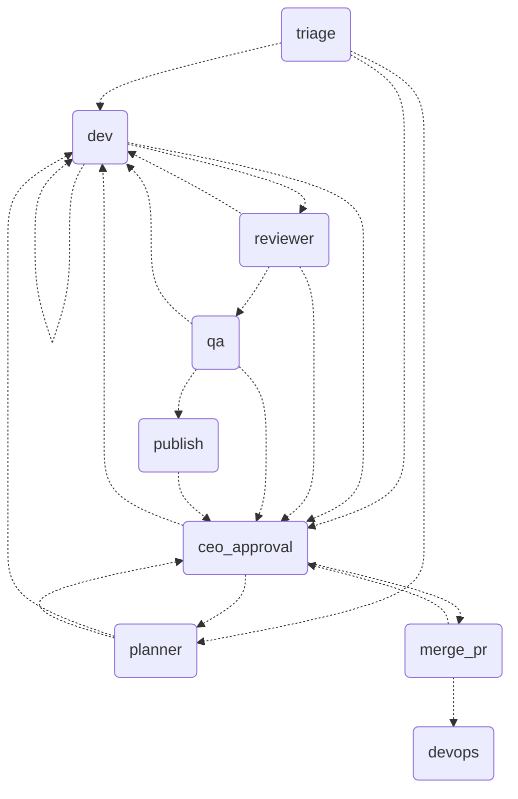

# Orchestrator

Flow control in code, not in prompts: a LangGraph.js graph orchestrates `claude -p` agents with code-verified guardrails.

- **Daily use (`orch`, any repo):** `npm link` once, then in the target repo: `orch init` (writes `.orchestrator.json`; commit it), `orch run "request"`, `orch status [id]`, `orch approve <id> ["answer"]`, `orch reject <id> "reason"`, `orch clean <id>|--all [--force]` (removes worktree, branch and state of finished tickets). State lives in `ORCH_HOME` (default `~/.orchestrator`); without `npm link`, use `npm run orch -- <command>`.
- **Token cap and alerts:** `TOKEN_CAP_DAILY` is a rolling 24h cap over every agent call (stops with an escalation, `orch status` shows usage); tune the number to your plan. `NOTIFY_URL` gets a plain-text POST when a ticket waits for you (e.g. an ntfy.sh topic on your phone).
- **Target repo rules:** the dev receives the repo's `CLAUDE.md` (read from the base commit, capped at 8000 chars) because `claude -p` with these flags does not load it by itself (checked: the model answered UNKNOWN to a canary in it).
- **Run (tracer):** `cp .env.example .env && npm ci && npm test`; end-to-end ticket: `echo approve | npm run tracer -- --clean` (uses the Claude Code login, no key). Real repo: `--repo <path> --id T-1 "request"`. Approve later from another process: add `--db state.json`, then rerun with `--resume`. Sweep stored tickets for stalled, looping or over-budget ones (free, rule-based): `npm run watchdog -- --db state.json` (`--llm` adds the Watchdog agent).
- **Pick a model per stage:** `npm run eval:review|eval:stages|eval:dev -- --models a,b --reps 3` score a model on cases with known answers (dev uses hidden acceptance tests). The measured matrix is in `.claude/docs/orchestrator/08-real-repo-validation.md`; `.env.example` ships what it supports.
- **ENV:** `AGENTS_DIR` (default `../.claude/agents`; `examples/agents` runs on its own), `MODEL_*`/`EFFORT_*`/`TURNS_*` per role, `TOKEN_BUDGET_TICKET`, `EXECUTOR`, `PUBLISHER` (`github` opens a draft PR), `RETRY_DELAYS_MS` (waits between retries of a busy API, default `5000,20000`; a usage limit is never retried). `.env.example` runs the read-only nodes on a cheaper model.
- **Per repo:** `.orchestrator.json` at the repo root (read from the base commit, so a ticket cannot edit it): `test` is the plain test command (default `npm test`; e.g. `pytest -q`), `merge` is `pr` (default: the PR is left to you) or `auto` (squash-merge after you approve, only with a green, stable CI on the exact commit you approved; never `--admin`, so branch protection still applies). A failed merge escalates; answer `retry` after fixing the CI.
- **Back to the old flow:** delete `orchestrator/`; nothing outside it depends on it.
- **Defenses:** worktree per ticket, minimal env, per-role permissions, evidence (commit, `npm test`, diff) checked in code, author ≠ reviewer ≠ QA, max 3 revisions and 5 tickets, token budget, merge/deploy only with the CEO.
- **Limits:** a `Bash` allowlist is weak (the real barrier is a worktree without secrets); the checkpointer is a JSON file; deploy is simulated; QA reads the diff and does not run the tests (the graph does and hands it the verified evidence); validated on a handful of tickets in a throwaway repo; individual and local use, not a service for third parties.
