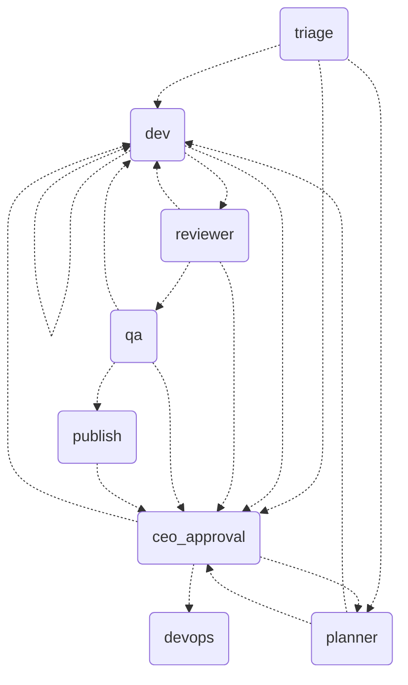

# Orchestrator

Flow control in code, not in prompts: a LangGraph.js graph orchestrates `claude -p` agents with code-verified guardrails.

- **Run:** `cp .env.example .env && npm ci && npm test`; end-to-end ticket: `echo approve | npm run tracer -- --clean` (uses the Claude Code login, no key). Real repo: `--repo <path> --id T-1 "request"`. Approve later from another process: add `--db state.json`, then rerun with `--resume`.
- **ENV:** `AGENTS_DIR` (default `../.claude/agents`; `examples/agents` runs on its own), `MODEL_*`/`EFFORT_*`/`TURNS_*` per role, `TOKEN_BUDGET_TICKET`, `EXECUTOR`, `PUBLISHER` (`github` opens a draft PR). `.env.example` runs the read-only nodes on a cheaper model.
- **Back to the old flow:** delete `orchestrator/`; nothing outside it depends on it.
- **Defenses:** worktree per ticket, minimal env, per-role permissions, evidence (commit, `npm test`, diff) checked in code, author ≠ reviewer ≠ QA, max 3 revisions and 5 tickets, token budget, merge/deploy only with the CEO.
- **Limits:** a `Bash` allowlist is weak (the real barrier is a worktree without secrets); the checkpointer is a JSON file; deploy is simulated; QA reads the diff and does not run the tests (the graph does); validated on a handful of tickets in a throwaway repo; individual and local use, not a service for third parties.
