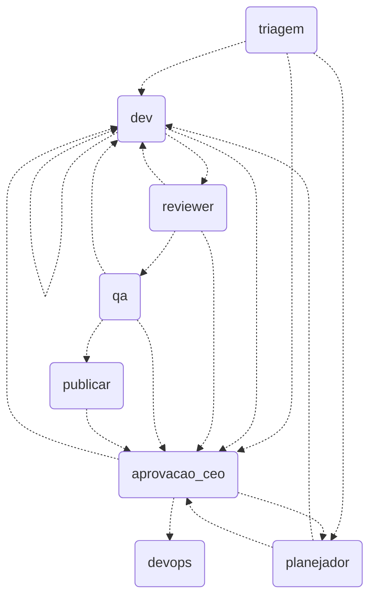

# Orchestrator

Controle de fluxo em código, não em prompt: um grafo LangGraph.js orquestra agentes `claude -p` com guardrails verificados por código.

- **Rodar:** `cp .env.example .env && npm ci && npm test`; ticket de ponta a ponta: `echo aprovar | npm run tracer -- --limpar` (usa o login do Claude Code, sem chave).
- **ENV:** `AGENTS_DIR` (padrão `../.claude/agents`; `examples/agents` roda sozinho), `MODEL_*`/`EFFORT_*`/`TURNOS_*` por papel, `TOKEN_BUDGET_TICKET`, `EXECUTOR`, `PUBLICADOR`.
- **Voltar ao fluxo antigo:** apague `orchestrator/`; nada fora dele depende disso.
- **Defesas:** worktree por ticket, env mínimo, permissões por papel, evidência (commit, `npm test`, diff) conferida em código, autor ≠ revisor ≠ QA, máx. 3 revisões e 5 tickets, orçamento de tokens, merge/deploy só com o CEO.
- **Limites:** `Bash` com allowlist é fraco (a barreira real é worktree sem segredos); checkpointer em memória; deploy é simulado; publicador `github` não testado contra remoto; uso individual e local, não é serviço para terceiros.
