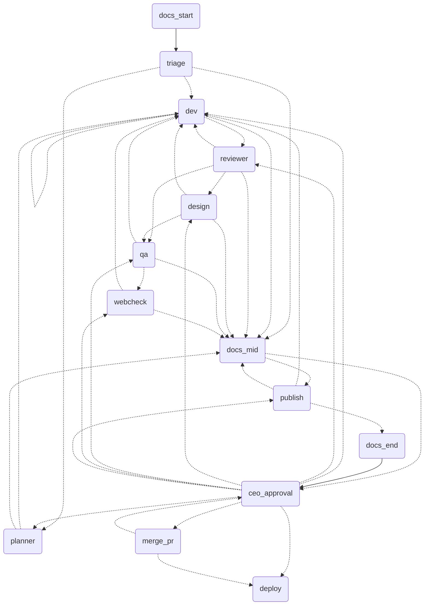

# Reference: commands, environment, per-repo config, graph

Every `orch <command>` is `npm run orch -- <command>`, run from `orchestrator/`. `--repo <path>` targets another repo.

## Commands

| Command | What it does |
|---|---|
| `orch setup <repo> [--team <name>] [--no-install] [--yes]` | Drop-in: copies this folder to `<repo>/orchestrator` (never overwriting; leaves out `node_modules`, `.env`, `.state`), creates `.env` from `.env.example`, runs `npm ci`, asks before downloading Chromium for `webcheck` (`--yes` accepts, no terminal skips), then runs `init`. Committing `orchestrator/` and `.orchestrator.json` stays with you. |
| `orch init` | Writes `../.orchestrator.json` (commit it). Warns when `package.json` has a bare `node --test`. |
| `orch run "request"` | Runs the graph on a request. Warns when the repo is behind its upstream. |
| `orch status [id]` | Lists tickets, then incidents; shows token usage and `docs!` warnings. |
| `orch continue <id>` | Resumes a run that was killed mid-graph. |
| `orch approve <id> ["answer"]` | CEO approval (for a deploy it shows the environment and the exact commands). |
| `orch reject <id> "reason"` | CEO rejection. |
| `orch clean <id>\|--all [--force] [--remote]` | Removes worktree, branch and state of finished tickets; `--remote` also deletes `ticket/<id>` on the push remote. Before deleting it appends one line to `ORCH_HOME/metrics.jsonl`: route, tasks, revisions, escalations, time, tokens and cost, total and per node. |
| `orch watch` | One monitor pass over deployed tickets (see [12-operations.md](12-operations.md)). |
| `orch rollback <incident-id> [--config-reviewed]` | Your approval of the proposed rollback; `--config-reviewed` accepts a changed `.git/config` after review. |
| `orch chaos <ticket-id> <scenario>\|--clear` | Injects (or clears) a failure on a sandbox deploy (see [12-operations.md](12-operations.md)). |
| `npm run tracer -- --clean` | End-to-end ticket on the Claude Code login, no key: `echo approve \| npm run tracer -- --clean`. Real repo: `--repo <path> --id T-1 "request"`. Approve later from another process: add `--db state.json`, rerun with `--resume`. |
| `npm run watchdog -- --db state.json` | Free, rule-based sweep for stalled, looping or over-budget tickets; `--llm` adds the Watchdog agent. |
| `npm run eval:review\|eval:stages\|eval:dev -- --models a,b --reps 3` | Scores a model per stage on cases with known answers (dev uses hidden acceptance tests). Matrix in [08](08-real-repo-validation.md); `.env.example` ships what it supports. |
| `npm run typecheck` | `tsc --noEmit`. |
| `npm run test:unit`, `npm run test:int`, `npm test` | Unit tests, integration tests, both. |

## Environment (`.env`, from `.env.example`)

| Variable | Meaning |
|---|---|
| `AGENTS_DIR` | Role prompts; default `agents/` (bundled, the single prompt source). Pointing it at the `.claude/agents` pointer stubs fails loudly. |
| `MODEL_*`, `EFFORT_*`, `TURNS_*` | Per role (e.g. `MODEL_REVIEWER`, `TURNS_DEV`); `.env.example` runs the read-only nodes on a cheaper model. `MODEL_DOCS` and `TURNS_DOCS` tune the docs agent. |
| `TOKEN_BUDGET_TICKET` | Token budget per ticket. |
| `TOKEN_CAP_DAILY` | Rolling 24h cap over every agent call; stops with an escalation, `orch status` shows usage. Tune to your plan. |
| `NOTIFY_URL` | Plain-text POST when a ticket waits for you (e.g. an ntfy.sh topic on your phone). |
| `EXECUTOR` | Agent executor. |
| `PUBLISHER` | `github` opens a draft PR. |
| `RETRY_DELAYS_MS` | Waits between retries of a busy API, default `5000,20000`; a usage limit is never retried. |
| `ORCH_HOME` | State and external config (default `orchestrator/.state`): `tickets/<id>.json`, plus `tickets/<id>.lock` while a command runs (a second command refuses with "already running"; a lock from a dead process is replaced). |
| `ORCH_WORK` | Ticket worktrees and deploy checkouts (default `~/.orchestrator/work`), outside the repo so the agent cannot reach its `.env` with `../`. |

## Per-repo config

`.orchestrator.json` at the repo root, read from the base commit (a ticket cannot edit it). The same keys can live in
`ORCH_HOME/config.json`; the in-repo file wins per key.

| Key | Meaning |
|---|---|
| `test` | Plain test command, no glob (default `npm test`; e.g. `pytest -q`). A bare `node --test` also runs `orchestrator/tests` in every worktree and fails: point it at a scoped npm script (e.g. `npm run test:app`). |
| `merge` | `pr` (default: the PR is left to you); `auto` (squash-merge after approval, only with green, stable CI on the exact approved commit; never `--admin`; a failed merge escalates, answer `retry` after fixing CI); `local` (solo repos: main fast-forwards to the approved commit; refuses with uncommitted changes, a moved main or another branch checked out). |
| `publisher` | `github` or `none`. |
| `push_remote` | Default `origin`. |
| `base_repo` | `owner/name` of the upstream the PR targets. |
| `disclosure` | Default `true`: the PR body says it came from an automated pipeline. |
| `install` | `true` runs `npm ci --ignore-scripts` on the host in each new worktree, from the base commit lockfile, so lint, `tsc` and `next build` can be the test command. Before every verification it wipes what the agent left outside the commit (`git clean -fdX`) and reinstalls. A diff touching `package-lock.json` (like `package.json`) goes to the CEO. Needs a committed lockfile and network. |
| `deploy`, `webcheck` | External config only (`ORCH_HOME/config.json`); see [12-operations.md](12-operations.md). |

Repo you cannot push to: `gh repo fork --remote`, then in `ORCH_HOME/config.json`:

```json
{ "test": "npm test", "merge": "pr", "push_remote": "fork", "base_repo": "upstream-owner/project" }
```

Target repo rules: the dev receives the repo's `CLAUDE.md` (from the base commit, capped at 8000 chars) because
`claude -p` with these flags does not load it by itself (checked: the model answered UNKNOWN to a canary in it).

## Graph


