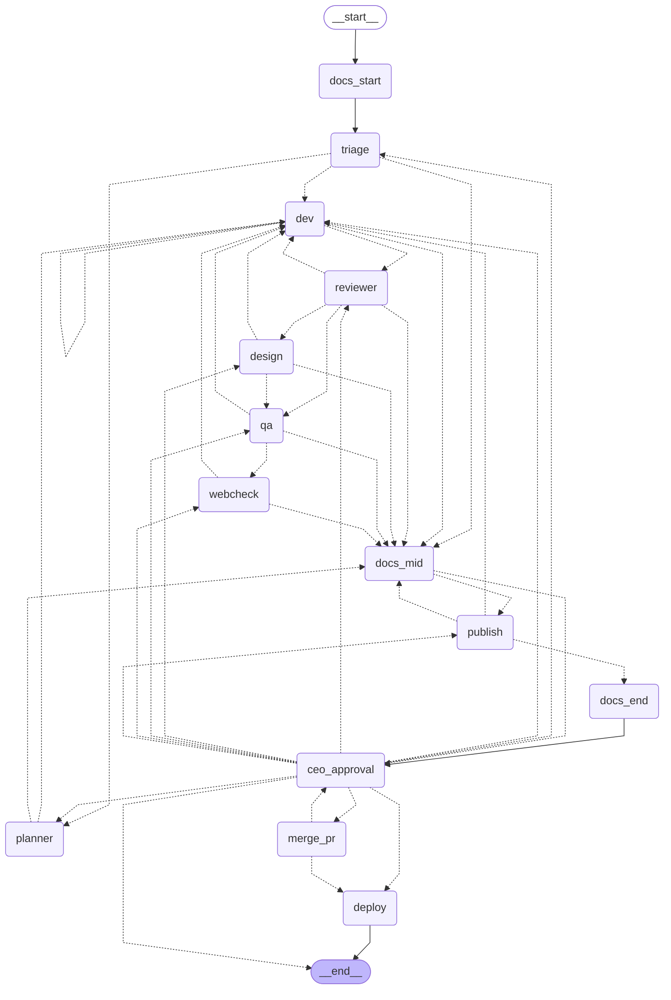

# Reference: commands, environment, per-repo config, graph

Every `orch <command>` is `npm run orch -- <command>`, run from `orchestrator/`. `--repo <path>` targets another repo.

## Commands

| Command | What it does |
|---|---|
| `orch setup <repo> [--team <name>] [--no-install] [--yes]` | Drop-in; refuses if `<repo>/orchestrator` already exists. Copies this folder to `<repo>/orchestrator` (never overwriting; leaves out `node_modules`, `.env`, `.state`), creates `.env` from `.env.example`, runs `npm ci`, asks before downloading Chromium for `webcheck` (`--yes` accepts, no terminal skips), then runs `init` and prints the lines to add to the host's `biome.json` (`"!orchestrator"`, `"!.vscode"`) and `tsconfig.json` (`"exclude": ["orchestrator"]`); it does not edit them, and without them the host's `verify` fails on `orchestrator/`. Committing `orchestrator/` and `.orchestrator.json` stays with you, so tickets branch from a base that has them. By hand: copy this folder to the repo root, then `cd orchestrator && npm ci && cp .env.example .env`. |
| `orch init [repo] [--team <all\|web\|api\|mobile\|ai>]` | Writes `../.orchestrator.json` (commit it) with that team's specialties and checks for `CLAUDE.md`. Warns when `package.json` has a bare `node --test`. |
| `orch team "<need>" [--repo <path>] [--yes]` | Agents propose the team and the stack (respecting an existing one); after you confirm, writes them to `.orchestrator.json`. |
| `orch run "request"` | Runs the graph on a request. Warns when the repo is behind its upstream. Also warns when the main checkout has uncommitted changes (the ticket does not see them). |
| `orch adopt [--title "<what they do>"]` | The uncommitted changes of the main checkout (tracked and untracked, not ignored) become a ticket: stashed, applied in the ticket worktree, committed by the dev in atomic commits following the repo's log pattern without changing a byte, then review, QA, docs and CEO approval. The main checkout ends clean; on a failure before the graph starts the stash is kept and the message gives `git stash apply <sha>`. Refuses secret-looking files and a clean checkout. |
| `orch manual "<title>" --command "<cmd>" --criteria "<text>" [--criteria ...] [--expect a.json,b.csv] [--id <id>]` | A ticket a human runs, for data no agent may see: stored in `ORCH_HOME/manual/<id>.json` (`M-<base36>` by default), never enters the graph and no agent touches it. Prints the command, the criteria and the `orch evidence` line to run next; the orchestrator never runs the command. |
| `orch evidence <id> <files...> --exit <code>` | Attaches the output of a manual ticket (paths relative to where you typed the command). Checks only what needs no look at the data: exit code 0, every `--expect` name attached, each file a non-empty regular file, `.json` files parse. Each attempt goes into the history as metadata only (`exit`, name, size, sha256; never content); a pass closes the ticket, a failure exits 1 and leaves it open. |
| `orch backlog [--all]`, `orch backlog review <n...>` | Lists the open reviewer caveats of `backlog.jsonl` (`--all` includes reviewed ones), numbered by first appearance, with ticket and reviewer; `review` marks those numbers `reviewed` (turned into a later ticket or consciously dropped) by appending a line, so it never races a graph adding caveats. An unknown number writes nothing. |
| `orch demand new "<title>" [--repo <path>] [--id <id>]` | Creates a demand (`ORCH_HOME/demands/<id>.json`, `D-<base36>` by default) for the repo; `--demand <id>` on `run`, `adopt` and `manual` adds the new ticket to its tasks (checked before anything is created, so an unknown or closed demand costs nothing). Task status is read live from each ticket, never copied. |
| `orch demand ask <id> "<question>" --owner <who> [--task <ticket>]`, `orch demand answer <id> <n> "<answer>"` | The decision log: question, owner, date asked, answer and date answered. While a question is unanswered the demand shows as `waiting <n>d` (since the oldest one) in `orch status` and in `/daily-brief`. `--task` ties the decision to one task, which is how a task that will not be delivered gets an explicit decision. |
| `orch demand close <id>` | Blocking checklist, printed item by item (`ok` / `FAIL: ...`), closes only if all pass: every task delivered (`simulated_deploy`, `deployed`, `merged`; `closed` for a manual ticket) or with an answered decision tied to it (aborted, cleaned or missing tickets count as not closed); no unanswered question; no `open` backlog item from its tickets (`orch backlog review`); `git status --porcelain` of the repo empty; every delivered task with evidence (code: `evidence`; manual: an `evidence:` entry); when the repo config has `project_docs`, those files as they are on disk are coherent with the delivery (no `- [ ]` or `pending`/`todo` bullet naming a delivered task of the demand; when they claim a test count (`N tests`/`N testes`), one of the numbers is the pass+skip+fail of the last code task's last verified run). Each attempt goes into the demand's history; a refusal exits 1. |
| `orch status [id]` | Lists tickets, then manual tickets (open ones flagged `waiting: orch evidence <id>`), then demands (`open`, `waiting <n>d <- #n (owner): question`, `closed`), then incidents; `status <manual id>` shows its command, criteria and history, `status <demand id>` its tasks with live status and its decisions; shows token usage and `docs!` warnings. A ticket that is neither finished nor waiting and has no live process is flagged `no process running: orch continue <id>`. An `aborted` ticket whose every commit is already on the base branch (a hand cherry-pick, detected by patch-id) becomes `merged`. |
| `orch continue <id>` | Resumes a run that was killed mid-graph. The dev reruns over the commits already in the worktree: it receives their log and diff and must write a `brief` for the whole ticket. |
| `orch approve <id> ["answer"]` | CEO approval (for a deploy it shows the environment and the exact commands). Answers by pending type: `approval`, `approve` merges; `escalation`, a bare `approve` is refused, answer `retry`, `abort` or an instruction for the dev; `no_change`, `approve` closes the ticket (status `closed`) and any other text is an instruction for the dev; `host_review` (the diff changed a file that runs code on the host, shown in `host_diff`), `approve` allows exactly those versions and re-runs only the verification, any other text is an instruction for the dev. |
| `orch reject <id> [reason]` | Closes the ticket (`aborted`), whatever it is waiting for; the reason goes into its history. |
| `orch request-changes <id> "<reason>"` | Sends the ticket back to the dev with the reason as its instruction (counts as a revision on an approval). |
| `orch clean <id>\|--all [--force] [--remote]` | Removes worktree, branch and state of finished tickets (with `merge: local` or `auto` the worktree and branch already go away right after the deploy, so they stop counting toward the 5 active tickets); `--remote` also deletes `ticket/<id>` on the push remote. Before deleting it appends one line to `ORCH_HOME/metrics.jsonl`: route, tasks, revisions, escalations, time, tokens and cost, total and per node. |
| `orch watch` | One monitor pass over deployed tickets; incidents and hotfixes in [12-operations.md](12-operations.md). |
| `orch resolve <incident-id>` | Closes an incident by hand (the service is back, or you handled it elsewhere). |
| `orch rollback <incident-id> [--config-reviewed]` | Your approval of the proposed rollback; `--config-reviewed` accepts a changed `.git/config` after review. |
| `orch chaos <ticket-id> <scenario>\|--clear` | Injects (or clears) a failure on a sandbox deploy; scenarios in [12-operations.md](12-operations.md). |
| `npm run tracer -- --clean` | End-to-end ticket on the Claude Code login, no key: `echo approve \| npm run tracer -- --clean`. Real repo: `--repo <path> --id T-1 "request"`. Approve later from another process: add `--db state.json`, rerun with `--resume`. |
| `npm run watchdog -- --db state.json` | Free, rule-based sweep for stalled, looping or over-budget tickets; `--llm` adds the Watchdog agent. |
| `npm run eval:review\|eval:stages\|eval:dev -- --models a,b --reps 3` | Scores a model per stage on cases with known answers (dev uses hidden acceptance tests). Matrix in [08](08-real-repo-validation.md); `.env.example` ships what it supports. |
| `npm run typecheck` | `tsc --noEmit`. |
| `npm run test:unit`, `npm run test:int`, `npm test` | Unit tests, integration tests, both. |

## Environment (`.env`, from `.env.example`)

| Variable | Meaning |
|---|---|
| `AGENTS_DIR` | Role prompts; default `agents/` (bundled, the single prompt source). Point it elsewhere to use your own roles; pointing it at the `.claude/agents` pointer stubs fails loudly. |
| `MODEL_*`, `EFFORT_*`, `TURNS_*` | Per role (e.g. `MODEL_REVIEWER`, `TURNS_DEV`). Lookup: `X_<ROLE>`, then `X_DEFAULT`; throws if both are missing. `.env.example` runs the read-only nodes on a cheaper model. `MODEL_DOCS` and `TURNS_DOCS` tune the docs agent. |
| `TOKEN_BUDGET_TICKET` | Token budget per ticket (`.env.example`: 400000). Unset is a hard error (fail closed); the cap is multiplied by 1 + verified tasks, up to 7. |
| `TOKEN_CAP_DAILY` | Rolling 24h cap over every agent call (`.env.example`: 1500000); stops with an escalation, `orch status` shows usage. Unset means no cap and no ledger. Tune to your plan. |
| `NOTIFY_URL` | Plain-text POST when a ticket waits for you (e.g. an ntfy.sh topic on your phone). |
| `EXECUTOR` | Only built-in value is `claude-subscription` (default; uses the Claude Code login, no key). Anything else fails with `unknown EXECUTOR: <name>`. |
| `PUBLISHER` | `github` (opens a draft PR) or `none` (`.env.example`). Unset fails closed. |
| `RETRY_DELAYS_MS` | Waits between retries of a busy API, default `5000,20000`; a usage limit is never retried; empty disables retries. |
| `STALE_HOURS` | Watchdog: hours without movement before a ticket is flagged (default 24; a P0 waits 1h). |
| `MERGE_WAIT_MS` | How long `merge: auto` waits for CI (default 600000); no checks at all means no automatic merge. |
| `ORCH_HOME` | State and external config (default `orchestrator/.state`): `tickets/<id>.json`, plus `tickets/<id>.lock` while a command runs (a second command refuses with "already running"; a lock from a dead process is replaced); `backlog.jsonl`, one line per caveat an approving reviewer, design or QA left, with the origin ticket, and one more per review (append-only, last line wins); `manual/<id>.json`, one per manual ticket; `demands/<id>.json`, one per demand. |
| `ORCH_WORK` | Ticket worktrees and deploy checkouts (default `~/.orchestrator/work`), outside the repo so the agent cannot reach its `.env` with `../`. |

## Per-repo config

`.orchestrator.json` at the repo root, read from the base commit (a ticket cannot edit it). The same keys can live in
`ORCH_HOME/config.json`; the in-repo file wins per key.

| Key | Meaning |
|---|---|
| `test` | Plain test command, no glob (default `npm test`; e.g. `pytest -q`), or a list of them that must all pass (e.g. `["npm test", "npm run lint"]`): they run in order, the first failure is the reason and the dev may run each one. A bare `node --test` also runs `orchestrator/tests` in every worktree and fails: point it at a scoped npm script (e.g. `npm run test:app`). Its summary (node --test, pytest or jest) becomes the pass/skip/fail counts in the `tests:` evidence. |
| `merge` | `pr` (default: the PR is left to you); `auto` (squash-merge after approval, only with green, stable CI on the exact approved commit; never `--admin`; a failed merge escalates, answer `retry` after fixing CI); `local` (solo repos: main fast-forwards to the approved commit; refuses with uncommitted changes or another branch checked out. If main moved, the ticket is rebased onto it and the suite runs again: merged without asking when main touched none of the ticket's files, a new approval when it did, back to the dev when the suite breaks, an escalation with the files on a conflict). |
| `publisher` | `github` or `none`. |
| `push_remote` | Default `origin`. |
| `base_repo` | `owner/name` of the upstream the PR targets. |
| `project_docs` | List of up to 10 tracked `.md` paths (`README.md`, `docs/CHANGELOG.md`). Before review, the docs node reads them, may rewrite them and commits the change on the ticket branch (`docs: update ...`), so review, QA and the approved sha cover it. Only exact listed paths are written (no symlink, no secret path); a problem is a `pre:` docs warning, never a block. Empty by default: the phase does not run. Read from the base commit like `test`, so a ticket cannot widen its own list; `orchestrator/`, `.github/` and secret paths are always refused. |
| `disclosure` | Default `true`: the PR body says it came from an automated pipeline. |
| `install` | `true` runs `npm ci --ignore-scripts` on the host in each new worktree, from the base commit lockfile, so lint, `tsc` and `next build` can be the test command. Before every verification it wipes what the agent left outside the commit (`git clean -fdX`) and reinstalls, so a planted file in `node_modules` never runs. A diff touching `package-lock.json` (like `package.json`) goes to the CEO as `host_review`. Needs a committed lockfile and network. |
| `deploy`, `webcheck` | External config only (`ORCH_HOME/config.json`); see [12-operations.md](12-operations.md). |

Repo you cannot push to: `gh repo fork --remote`, then in `ORCH_HOME/config.json`:

```json
{ "test": "npm test", "merge": "pr", "push_remote": "fork", "base_repo": "upstream-owner/project" }
```

Target repo rules: the dev receives the repo's `CLAUDE.md` (from the base commit, capped at 8000 chars) because
`claude -p` with these flags does not load it by itself (checked: the model answered UNKNOWN to a canary in it).

## Graph

Generated from `src/graph.ts`; regenerate with `buildGraph().getGraphAsync()` then `.drawMermaid()` (needs `TOKEN_BUDGET_TICKET` set).
`ceo_approval` is the only human gate: every merge, deploy, escalation and "no change needed" passes through it.
The pending payload (`orch status <id>`) carries `revisions` and `last_node`, plus the dev's `explanation` and `brief` even when verification failed.
A request that needs no code (a check or review) ends with the dev committing nothing and setting `no_change`; with a clean worktree and no commit the ticket asks the CEO instead of failing.


